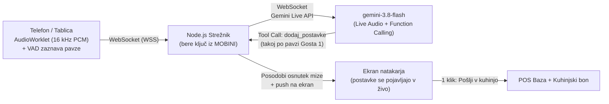

# Načrt: Glasovno AI naročanje pri mizi (`MOBINI` + `gemini-3.8-flash`)

Ta načrt združuje vse preverjene ugotovitve iz razvoja `@ros/ai-assistant` (v `ros-node-shared`) in jih prilagaja za **gostinsko/mobilno naročanje (`MOBINI`)** po točkah 0–4.

---

## 0. Skupna osnova iz `@ros/ai-assistant` (preverjeno v praksi)

- **Centralni ROS poslovni model:** Naročnik ne potrebuje osebne Gemini naročnine; en strežniški API ključ (pay-as-you-go), strošek pod pol centa na ukaz, na plačljivem nivoju Google podatkov ne uporablja za treniranje.
- **HTTPS zahteva za mikrofon:** Brskalniki na telefonih/tablicah/PC dovolijo mikrofon (`MediaRecorder` / `AudioWorklet`) samo na **`https://...`** ali `http://localhost` (za razvojni test v Chrome/Edge pa `chrome://flags/#unsafely-treat-insecure-origin-as-secure`).
- **Varnostni model "Osnutek → Potrdi":** AI nikoli ne pošlje bona v kuhinjo ali zaključi računa brez potrditve natakarja; vse AI akcije tečejo pod pravicami prijavljenega natakarja in se beležijo v kronologijo.
- **Skupna koda v `C:\GeminiCli\ros-node-shared`:** Jedro (`@ros/ai-assistant`) ostane skupno, projekt `MOBINI` doda samo svoja gostinska orodja (mize, jedilnik/artikli, opombe, hodi, kuhinjski boni).

---

## 1. Model: `gemini-3.8-flash` (brez `2.5-flash`)

- Privzeti model je **`gemini-3.8-flash`** (stari `gemini-2.5-flash` za nove uporabnike ni več na voljo).
- Ime modela naj ne bo trdo zakodirano — bere se iz konfiguracije (`MOBINI`, privzeto `gemini-3.8-flash`), tako da je prehod na prihodnje verzije (npr. `gemini-4.x-flash`) mogoč brez menjave kode.

---

## 2. Varna hramba API ključa v tabeli `MOBINI`

Namesto (ali poleg) `.env` datoteke se nastavitve hranijo neposredno v tabeli **`MOBINI`** (enako kot `NAROCILAINI`):

| Sekcija / Ključ v `MOBINI` | Primer vrednosti | Namen |
|---|---|---|
| `AI / GeminiApiKey` | `AIza...` *(šifrirano ali skrito)* | Strežniški API ključ za Gemini |
| `AI / GeminiModel` | `gemini-3.8-flash` | Aktivni model za tekst in zvok |
| `AI / AssistantEnabled` | `1` / `0` | Vklop/izklop glasovnega asistenta |
| `AI / LiveAudioMode` | `vad` / `live_ws` / `push` | Način glasovnega vnosa |

**Varnostna pravila za `MOBINI`:**
1. **Prioriteta branja:** `process.env.GEMINI_API_KEY` (če je nastavljen za test) → sicer `MOBINI` (`AI / GeminiApiKey`).
2. **Ključ nikoli ne zapusti strežnika:** V brskalnik/telefon se nikoli ne pošlje API ključ (tudi pri `AudioWorklet` / WebSocketu se klient poveže na naš Node.js strežnik, strežnik pa na Gemini).
3. **Maskiranje:** V nastavitvenem UI in v SQL/audit dnevnikih (`DEBUGLEVEL`) se `GeminiApiKey` vedno prikaže maskiran (`AIza••••cycs`).

---

## 3. Večstopenjsko naročilo s pavzami: *Novo naročilo* vs. *Nadaljuj naročilo*

Pri mizi naročilo ni en sam stavek — poteka **po gostih s pavzami in popravki** (*Gost 1: predjed + glavna jed → pavza → Gost 2: pijača + glavna jed → popravek za Gosta 1*).

### Stanje aktivnega naročila (Draft / Košarica za mizo)
Vsako odprto naročilo v seji ima jasno strukturo:
- `mizaId` (npr. Miza 12)
- `narociloId` (prazno = **novo naročilo**, obstoječi ID = **nadaljuj naročilo**)
- `postavke[]`: `{ vrsticaId, artikelId, naziv, kolicina, em, gostSt, hod ('PIJACA' | 'PREDJED' | 'GLAVNA' | 'SLADICA'), opomba ('brez čebule', 'medium') }`

### Nabor AI orodij za natakarja
| Orodje | Način | Kaj naredi |
|---|---|---|
| `odpri_ali_nadaljuj_narocilo({ mizaId, nacin: 'novo' \| 'nadaljuj' })` | `read/draft` | Preveri ali ima miza že odprto naročilo. Če izbere *nadaljuj*, naloži obstoječe postavke; če *novo*, odpre prazen osnutek. |
| `dodaj_postavke({ postavke[] })` | `draft` *(sproti na ekran)* | Poišče artikle v jedilniku/katalogu, dodeli **gost #** in **hod** (predjed/glavna/pijača) ter opombe (*brez čebule*), in jih takoj prikaže v osnutku na ekranu. |
| `spremeni_ali_odstrani_postavko({ opis, novaKolicina, zamenjavaArtikel, opomba })` | `draft` *(sproti na ekran)* | Zna razumeti naravne popravke: *"pri prvem gostu namesto pomfrija riž"*, *"storniraj eno pivo"*, *"še eno govejo juho"*. |
| `potrdi_in_poslji_v_kuhinjo()` | **`confirm` (obvezna potrditev)** | Šele ob kliku natakarja (ali izrecnem potrditvenem koraku) dejansko zapiše v POS bazo in pošlje bone na kuhinjski/šank tiskalnik. |

**Kako deluje pavza med Gost 1 in Gost 2:**
- Osnutek (`draft`) in kratka zgodovina mize ostaneta shranjena na strežniku/seji (tudi če je vmes 30 sekund ali 2 minuti pavze, ali če natakar zapre mikrofon in ga čez minuto spet odpre za Gosta 2).
- AI v kontekstu vedno vidi **trenutni seznam postavk v osnutku**, zato natančno ve, kaj je naročil Gost 1, ko Gost 2 reče *"meni isto, samo brez solate"*.

---

## 4. `AudioWorklet` — ali se lahko med narekovanjem že sproti knjižijo postavke?

**DA — tehnično je popolnoma mogoče**, vendar z eno zelo pomembno gostinsko varovalko:

> [!IMPORTANT]
> **Sprotno dodajanje v osnutek (DA) vs. končno knjiženje v kuhinjo (NE brez potrditve):**
> Med narekovanjem se postavke **sproti prikazujejo in knjižijo v osnutek naročila na ekranu** (v 1–1,5 sekunde po vsakem gostu). **Končni zapis v POS in tiskanje bonov v kuhinjo/šank** pa se sprožita šele, ko natakar na koncu klikne **Pošlji / Potrdi** — sicer bi si gost premislil (*"ah, raje ne pomfri"*), bon pa bi bil že natisnjen v kuhinji!

### Kako deluje tok z `AudioWorklet` + Gemini Live API (WebSocket)

### Realna primerjava dveh pristopov za gostinstvo (hrup + Wi-Fi)

| Pristop | Kako deluje pri mizi | Odpornost na slabši Wi-Fi v lokalu | Priporočilo |
|---|---|---|---|
| **Faza 1: `AudioWorklet` + lokalni VAD (zaznava 1,2 s pavze) → REST `gemini-3.8-flash`** | Mikrofon je odprt. Ko Gost 1 konča stavek (1,2 s tišine), `AudioWorklet` samodejno pošlje ta segment na `/ai/order-chunk` → čez ~1 s se postavke Gosta 1 pojavijo na ekranu. Natakar ne rabi nič klikati; ko spregovori Gost 2, se ponovi za Gosta 2. | **Zelo visoka** (vsak segment je majhen HTTP POST; če Wi-Fi za sekundo pade, se posnetek ponovno pošlje). | **Prva izbira za MVP v lokalu** — enak "magični" UX sprotnega dodajanja med gosti, a bistveno bolj robustno na Wi-Fi. |
| **Faza 2: `AudioWorklet` + polni WebSocket (Gemini Live API)** | Neprekinjen dvosmerni avdio tok prek WebSocket proxyja na Node.js. Najnižja latenca (~0,5–0,8 s) in sprotni prepis besedo-po-besedi. | Občutljivejše na prekinjanje Wi-Fi (zahteva samodejni reconnect + Nginx WebSocket konfiguracijo). | Nadgradnja za lokale z odličnim Wi-Fi in Bluetooth slušalkami. |

### Praktični detajli za hrupno restavracijo
- **Gumb *Pavza / Nadaljuj*** (ali *Drži za govor* način kot opcija v nastavitvah natakarja), da mikrofon ne posluša sosednje mize, kadar gre natakar mimo.
- **Kratek kontekst jedilnika (Menu Caching):** Da Gemini 100 % natančno prepozna imena jedi (npr. *"žlikrofi"*, *"šopska"*, *"union 0,5"*), mu ob odprtju mize posredujemo kompakten seznam aktivnih artiklov/skupin (ali orodje za hitro iskanje po artiklih).

---

## 5. Predlog fazne izvedbe za `MOBINI`

1. **Faza 1 — Konfiguracija v `MOBINI` + osnutek naročila:**
   - Branje `AI / GeminiApiKey` in `AI / GeminiModel` (`gemini-3.8-flash`) iz `MOBINI` z maskiranjem.
   - Podatkovni model osnutka naročila (`novo` / `nadaljuj`, gost #, hod, opombe) + orodja `dodaj_postavke` in `spremeni_ali_odstrani_postavko`.
2. **Faza 2 — `AudioWorklet` + VAD sprotno dodajanje po gostih:**
   - Avtomatska zaznava pavz med gosti (1,2 s tišine) → postavke se sproti pojavljajo v osnutku na ekranu medtem ko gostje še naročajo.
   - Gumb **Potrdi in pošlji v kuhinjo** za končno knjiženje v POS.
3. **Faza 3 (opcijsko) — Gemini Live WebSocket:**
   - Polni streaming prek WebSocket proxyja, če bo potrebna še nižja latenca in sprotni izpis besed.
